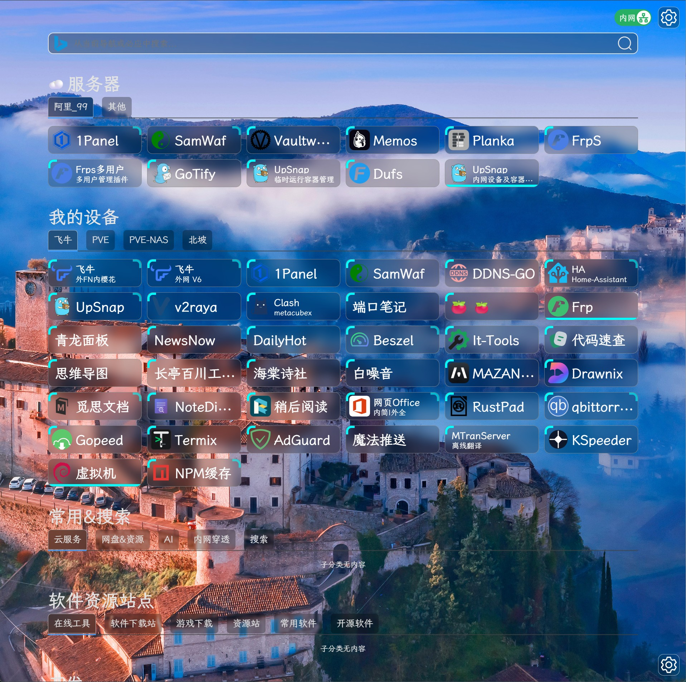
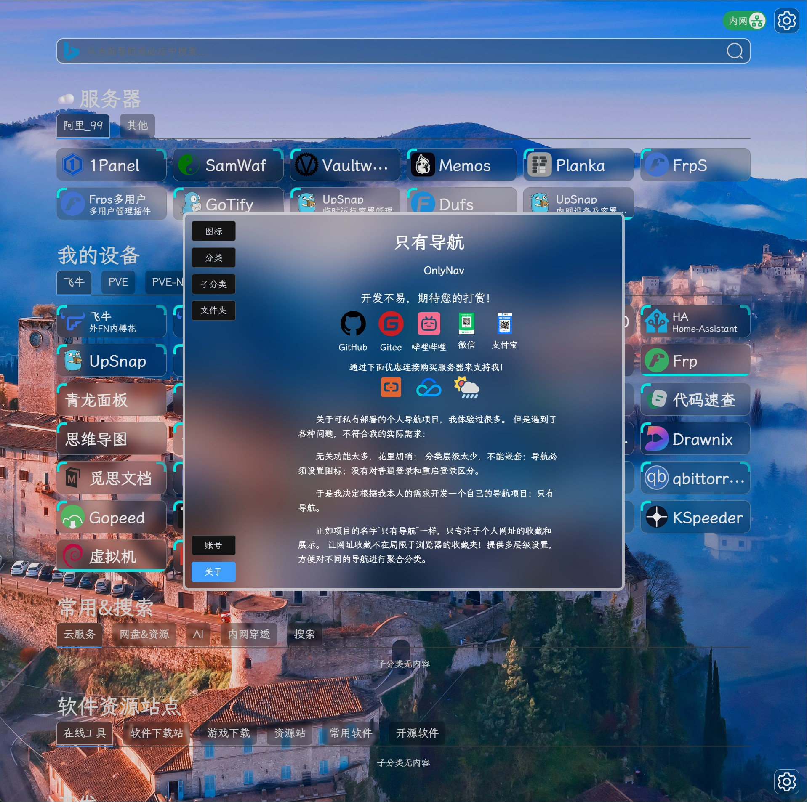
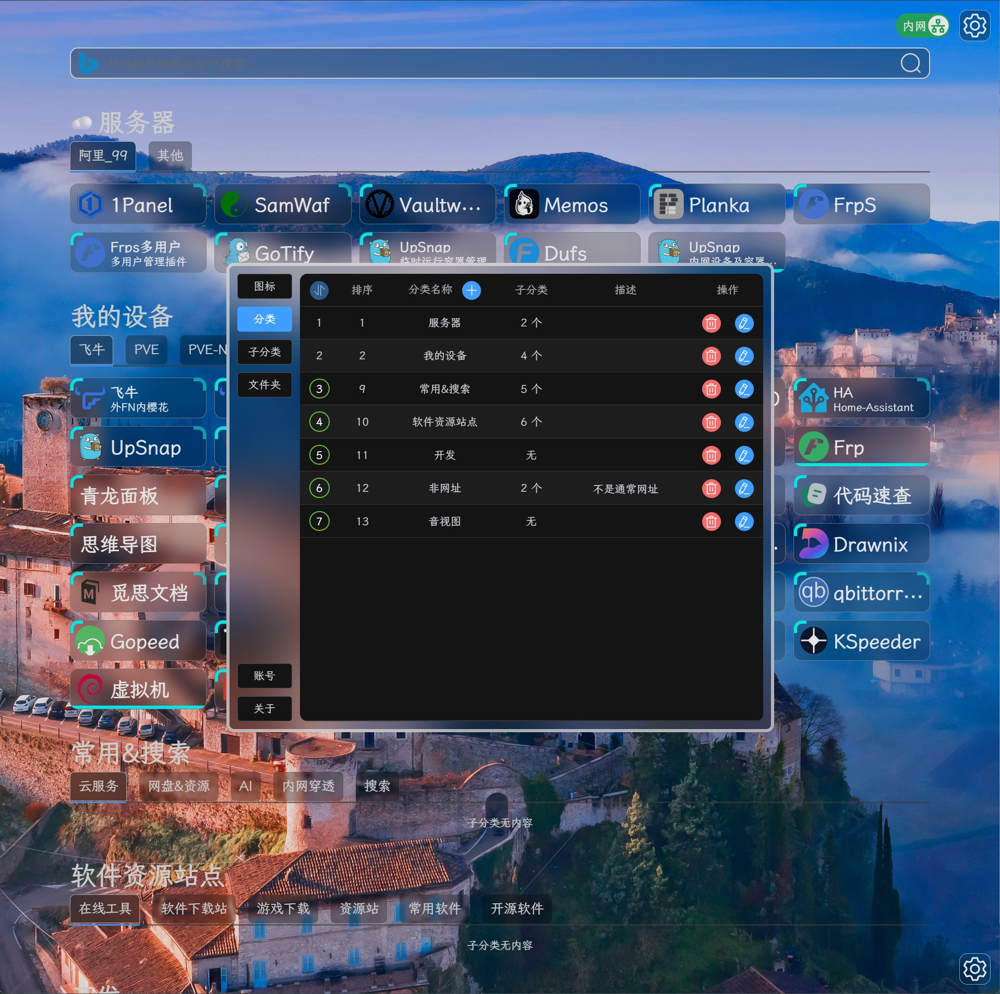
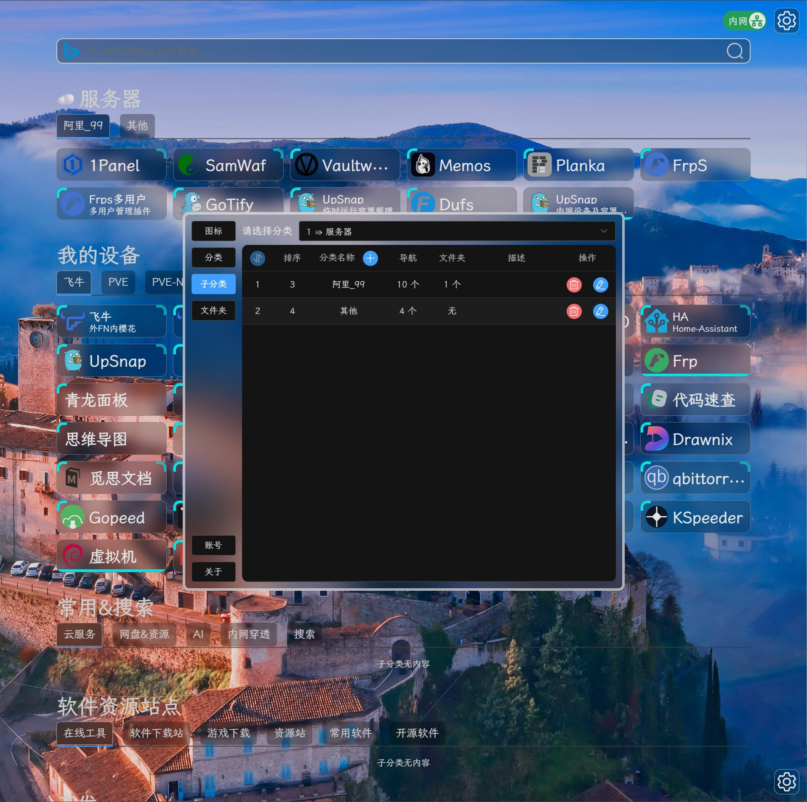
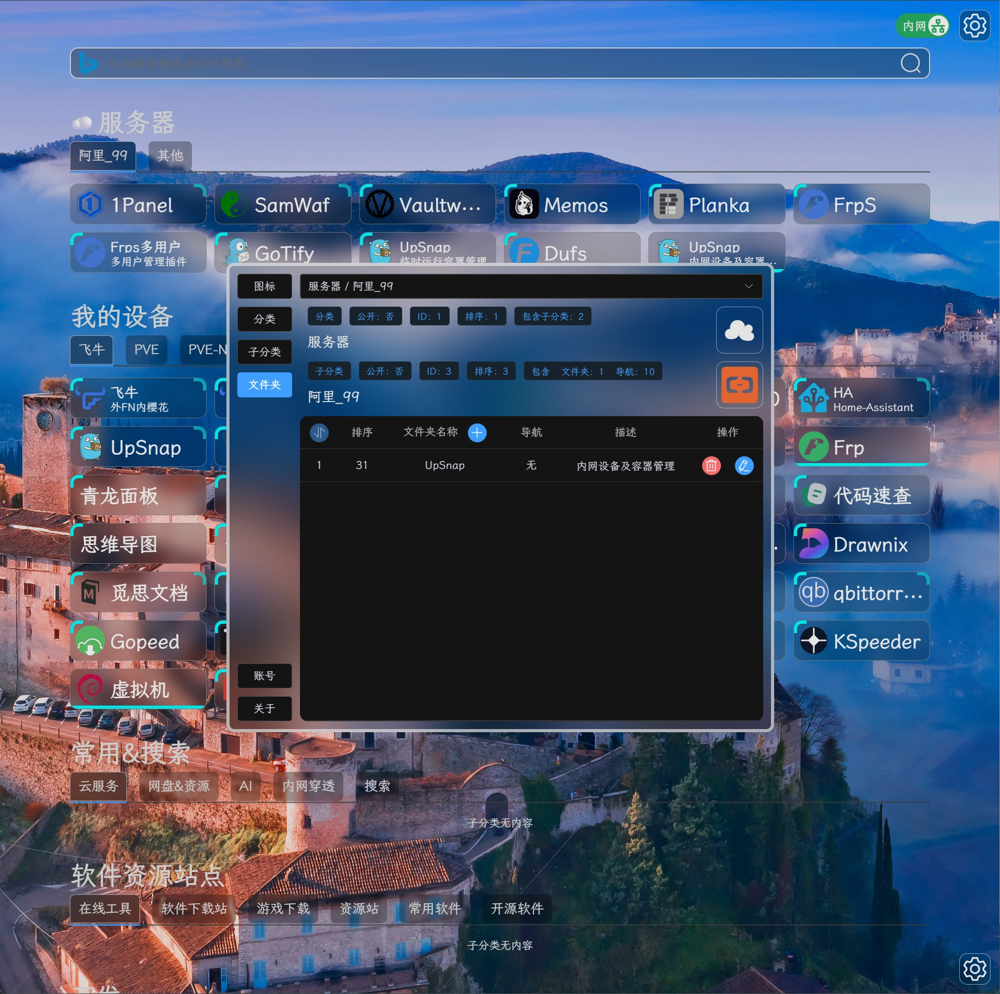
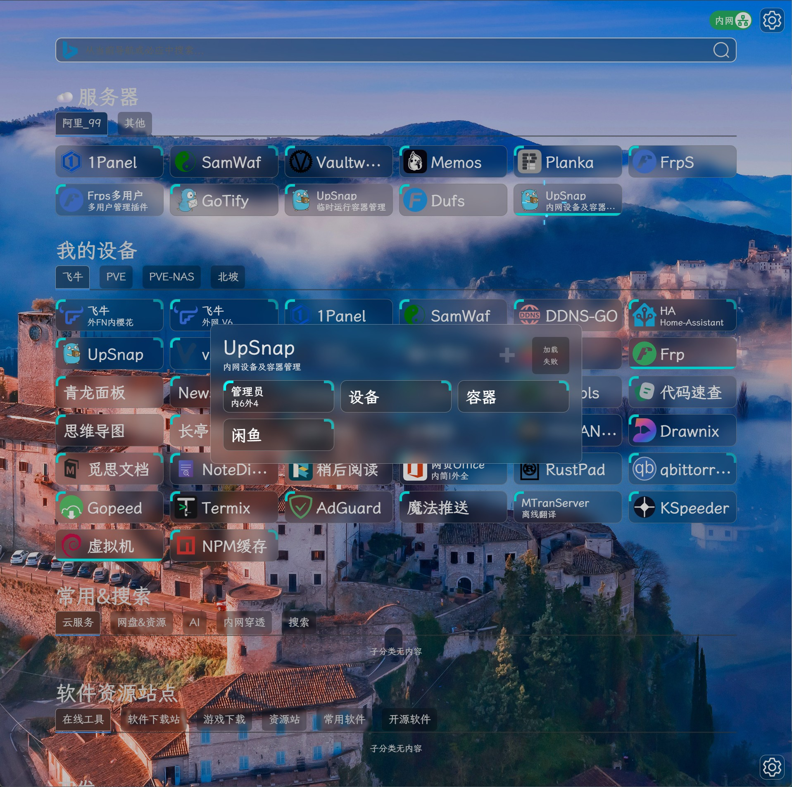
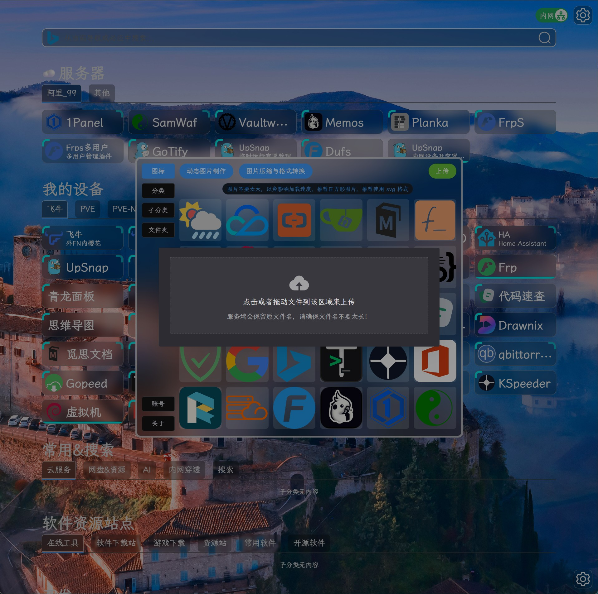
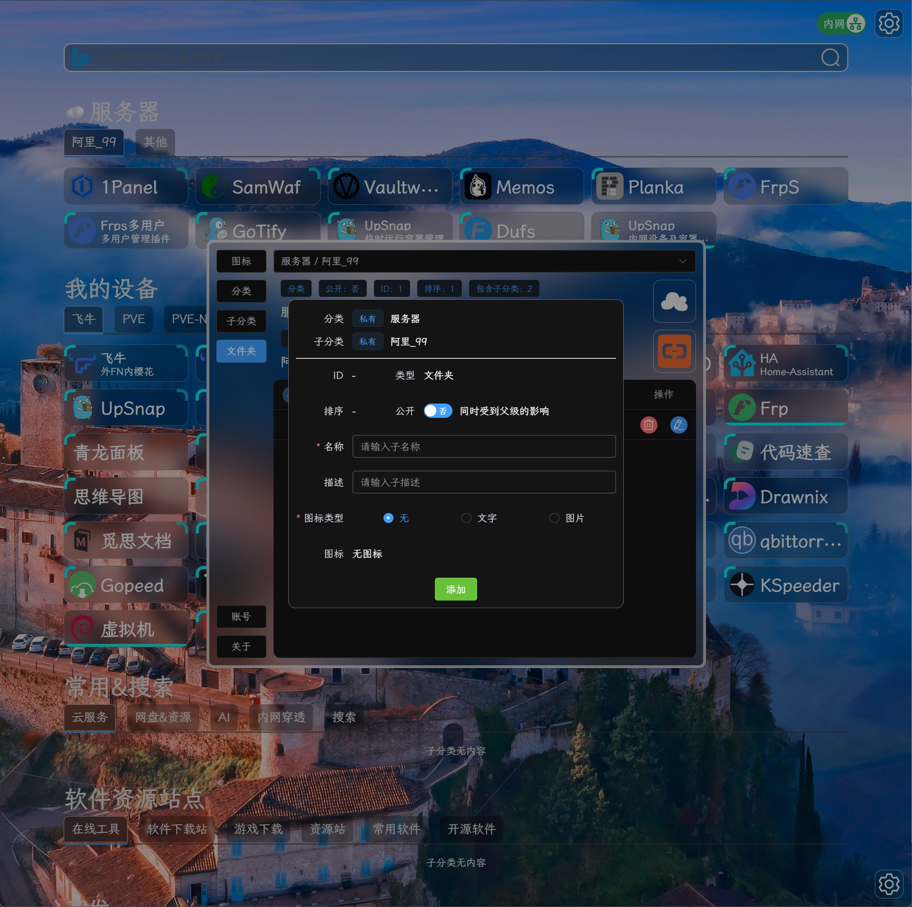
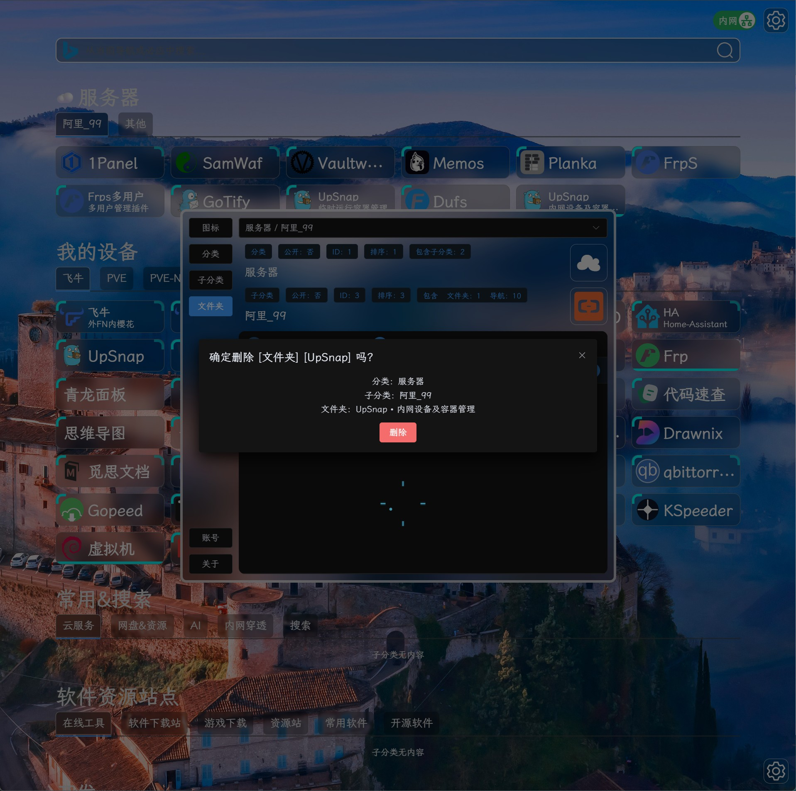
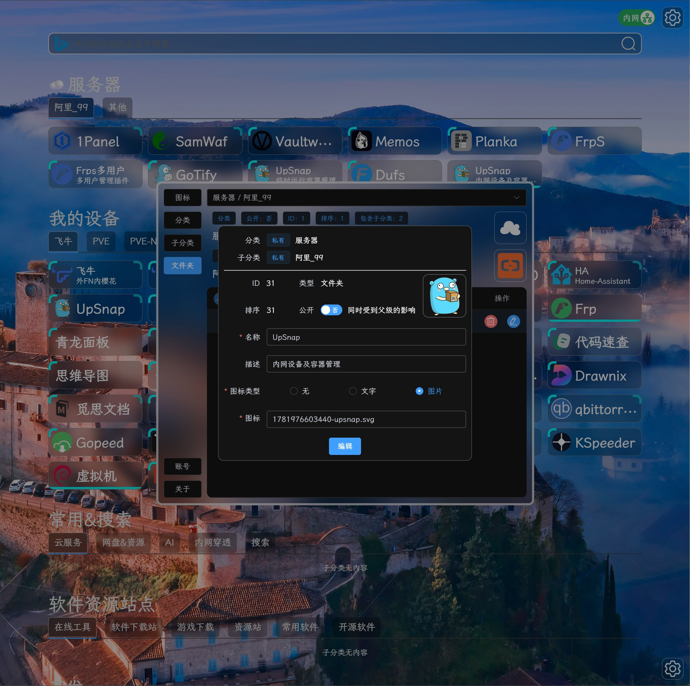

# 只有导航

关于可私有部署的个人导航项目，我体验过很多。 但是遇到了各种问题，不符合我的实际需求：

无关功能太多，花里胡哨； 分类层级太少，不能嵌套；导航必须设置图标；没有对普通登录和重启登录区分。

于是我决定根据我本人的需求开发一个自己的导航项目：**只有导航**。

正如项目的名字 **只有导航** 一样，只专注于个人网址的收藏和展示。 让网址收藏不在局限于浏览器的收藏夹！提供多层级设置，方便对不同的导航进行聚合分类。

当前项目的背景图片来自微软 Bing 官方提供的API接口，每次刷新都会返回一张随机壁纸。

- 仓库
  - GitHub仓库 https://github.com/Firfr/OnlyNav
  - Gitee仓库 https://gitee.com/firfe/OnlyNav
  - DockerHub https://hub.docker.com/r/firfe/only_nav

有问题请提 issue 或在我的B站留言。

欢迎关注我B站账号 [秦曱凧](https://space.bilibili.com/17547201) (读作 qín yuē zhēng)

有需要帮忙部署这个项目的朋友,一杯奶茶,即可程远程帮你部署，需要可联系。  
微信号 `E-0_0-`  
闲鱼搜索用户 `明月人间`  
或者邮箱 `firfe163@163.com`  
如果这个项目有帮到你。欢迎start。也厚颜期待您的打赏。

## 支持我

|            支付宝打赏             |           微信打赏            |
| :-------------------------------: | :---------------------------: |
|  |  |

有购买服务区需求的朋友可以通过下面的通过连接来购买服务器支持我

- [腾讯云](https://curl.qcloud.com/RJz7oNIa)
- [阿里云](https://www.aliyun.com/minisite/goods?userCode=napc1zre)
- [雨云](https://www.rainyun.com/MTA0OTAwMw==_)

## 镜像

从阿里云或华为云镜像仓库拉取镜像，注意填写镜像标签，镜像仓库中没有`latest`标签

容器内部端口`5191`。

- 国内仓库
  - AMD64镜像
    ```bash
    swr.cn-north-4.myhuaweicloud.com/firfe/only_nav:1.0.0
    ```
  - ARM64镜像
    ```bash
    swr.cn-north-4.myhuaweicloud.com/firfe/only_nav:1.0.0-arm64
    ```
- DockerHub仓库
  - AMD64镜像
    ```bash
    firfe/only_nav:1.0.0
    ```
  - ARM64镜像
    ```bash
    firfe/only_nav:1.0.0-arm64
    ```

## 部署

基础配置从 1.0 的配置文件方式改成了环境变量。文件 `账号设置.json` 不在生效。

| 环境变量  | 必须 | 默认值                    | 说明                                                                |
| --------- | ---- | ------------------------- | ------------------------------------------------------------------- |
| USER      | 是   | 无                        | 用户名，必须设置，常见简体中文、英文字母、数字以及 _!@#.- 长度 3-32 |
| PASS      | 是   | 无                        | 密码，必须设置，英文字母、数字以及 _!@#.- 长度 3-32                 |
| LONG_PASS | 否   | 无                        | 长期登录凭据，设置后开启长期登录功能                                |
| PORT      | 否   | `5191`                    | 端口                                                                |
| HOST      | 否   | `::`                      | 监听地址，默认 V4 V6 双栈，失败退回 V4                              |
| DATA_PATH | 否   | `/data`                   | 数据目录，这里是容器内部的目录，不建议修改                          |
| JWT       | 否   | `firfe_only_nav_jwt_1234` | JWT 密钥，不少于10位，非常建议自定义一个超度超过 32 位的            |
| STD_EXP   | 否   | `1`                       | 普通登录过期时间，默认 1 天，可以是小数，大于0.05 (约 1 小时)       |
| STD_DEV   | 否   | `1`                       | 普通登录设备数量，默认 1 台设备                                     |
| LNG_EXP   | 否   | `30`                      | 长期登录过期时间，默认 30 天，正整数，大于 7，太小了没有意义        |
| LNG_DEV   | 否   | `3`                       | 长期登录设备数量，默认 3 台设备                                     |

**长期登录**是相对与**普通登录**来说的，比如**普通登录**后账号在一天后会自动退出，这个适合临时登录，而**长期登录**方式默认 30 天后才会退出，这个适合在自己的设备上登录。默认功能关闭，只有在设置了长期登录凭据后功能才会开启。

### docker run 命令部署

```bash
docker run -dit \
--name only_nav \
--network bridge \
--log-opt max-size=1m \
--log-opt max-file=1 \
-p 5191:5191 \
-e USER=用户名 \
-e PASS=密码 \
-v ./data:/data \
firfe/only_nav:1.1.1
```

### compose 文件部署 👍推荐

```yaml
name: only_nav
services:
  only_nav:
    container_name: only_nav
    image: swr.cn-north-4.myhuaweicloud.com/firfe/only_nav:1.1.0
    network_mode: bridge
    restart: always
    logging:
      options:
        max-size: 1m
        max-file: "1"
    environment:
      USER: 用户名
      PASS: 密码
      LONG_PASS: 长期登录凭据
      # JWT 密钥
      # JWT: firfe_only_nav_jwt_1234
      # 普通登录过期时间
      # STD_EXP: 1
      # 普通登录设备数量
      # STD_DEV: 1
      # 长期登录过期时间
      # LNG_EXP: 30
      # 长期登录设备数量
      # LNG_DEV: 3
    ports:
      - 5191:5191
    volumes:
      - ./data:/data
```

## 效果截图

|      |                |
| :------------------------: | :----------------------------------: |
|      |            |
|  |  |
|      |                |
|      |                |
